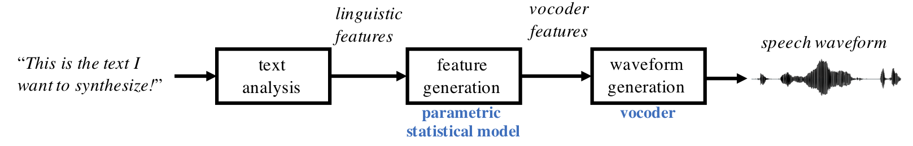
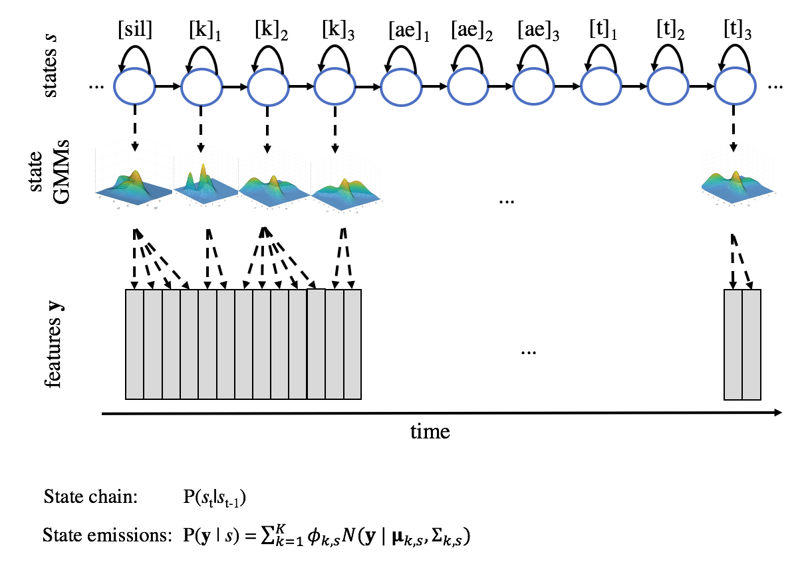
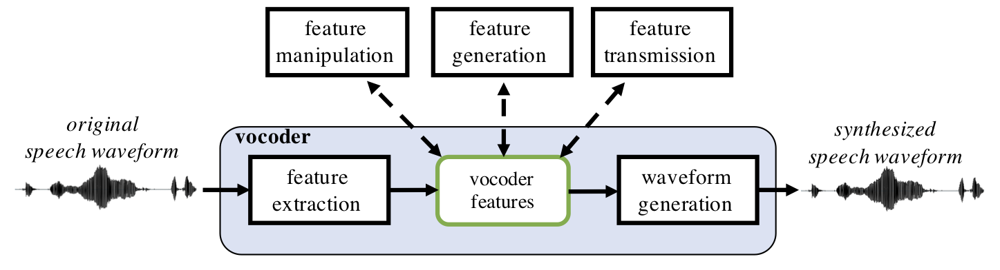
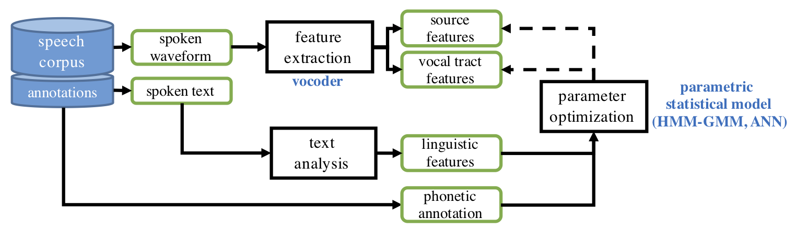

(content:spss)=
# Statistical parametric speech synthesis
  

While concatenative synthesis can reach highly natural synthesized
speech, the approach is inherently limited by properties of the speech
corpus used for the unit selection process. Concatenative systems can
only produce speech whose constituent segments (e.g., diphones) have
been pre-recorded. In order to make the synthesis sound natural, large
amounts of speech from a single speaker must therefore be available.
This limits the flexiblity of concatenative systems in producing
different voices, speaking styles, emotional expressions, or other
modifications to the sound that are common in everyday human
communication. 

As an alternative to the concatenative approach, statistical parametric
speech synthesis (SPSS) became the other main TTS approach in the 2000s
and 2010s {cite}`zen2009statistical,tokuda2013speech`. This is because it addresses the
main limitation of the concatenative systems — the lack of flexibility —
by generating the speech using statistical models of speech instead of
relying on pre-recorded segments. These statistical models are learned
from speech corpora using machine learning techniques, and they encode
information of how speech evolves as a function of time in the context
of a given input text.  In this respect, SPSS systems can be viewed as a
mirror image of [ASR](#content:asr) systems: while an ASR system
tries to convert speech from acoustic features to a string of words
using machine learning models, an SPSS system tries to convert a string
of words into acoustic features or directly to the acoustic waveform
using machine learning models. Both ASR and SPSS systems are typically
trained on a large amount of speech data with their transcriptions,
resulting in a set of *parameters* that describe *statistical
characteristics* of the speech data (hence "statistical parametric"
speech synthesis).

  


**Figure 1:** A schematic view of an SPSS system.

  

A full SPSS system consists of text analysis, feature generation, and
waveform generation modules. The classical approach to SPSS is based on
a combination of a *hidden-Markov model Gaussian mixture model*
(HMM-GMM) architecture for feature generation and a *vocoder* for
waveform generation, and these will be discussed in more detail below.
Recent advances in neural network-based SPSS are then reviewed at the
end.

  

### Feature generation 

Given the linguistic description of the text-to-be-synthesized, the
purpose of the feature generation is to transform the linguistic
features into a corresponding description of the acoustic signal.
Similarly to ASR, this component mediating the two levels is called *an
acoustic model*. Technically speaking, the acoustic model converts the
linguistic input into a series of acoustic features at a fixed
frame-rate (e.g., one feature frame every 10 ms) using a probabilistic
mapping between the two. The mapping is learned from a training speech
corpus.

A standard approach for the probabilistic mapping has been to use a
HMM-GMM as the statistical parametric model. Similarly to an HMM-GMM ASR
system, the states $s$ of the HMM correspond to parts of subword units
(e.g., parts of a phone, diphone, or triphone). Transition probabilities
P(s \| st-1) between the states describe how the speech evolves through
each subword unit and from a unit to another. Acoustic characteristics
associated with each state are modeled with a GMM, where the GMM
describes a probability distribution $P(y | s)$ over the possible
acoustic feature vectors in that state. Given a sequence of desired
subword units (as instructed by the linguistic features), the model can
be stochastically or deterministically sampled to produce a sequence of
acoustic features. These are then fed to *a waveform generation module*
to produce the actual speech signal. In the most basic form,
self-transitions from an HMM state to itself account for the duration
spent in that state (i.e., how many frames should the same acoustic
content be repeated). However, separate more advanced duration models
are often used to overcome the limitations of a first-order Markov chain
in modeling thetemporal dependencies and durational characteristics of
speech.

  


**Figure 2:** A visual illustration of HMM-GMM-based speech feature
generation. State sequence $s = \{s_1, s_2,...,s_{10}\}$ required for word "cat" (/k ae t/) is shown on
top, where each phoneme consists of three states: initial, center and
final state (e.g., $k_{1}$, $k_{2}$, and $k_{3}$). 
Each state is associated with an $N$-dimensional Gaussian mixture model
(GMM), where $N$ is the dimensionality of the speech features $y$. At
each time step, the GMM of the active state is sampled for a feature
vector $y_{t}$.  After this, a state transition can occur to
a next state or back to the current state, controlling the durational
aspects of the speech.


### Waveform generation with vocoders

A typical high-quality speech waveform consists of "continuous" (e.g.,
16-bit quantized) amplitude values sampled at 16 kHz. In addition, the
shape of the waveform is affected by several factors that do not
directly contribute to the naturalness or intelligibility of speech,
such as signal gain or phase and amplitude characteristics of the
recording and transmission chain. This means that mere 80 milliseconds
of a raw waveform — a typical length of one vowel — would correspond to
0.08 s\16 kHz = 1280-dimensional amplitude vector, and that this
vector could take countless of shapes for perceptually highly similar
sounds. Moreover, the values encoded in this vector would be highly
correlated with each other (see [LPC](#content:linearprediction)). Given the
high dimensionality, variability, and redundant nature of the waveform
signal representation, it is not an attractive target for statistical
parametric modeling with classical machine learning techniques (but see
also Neural SPSS below).

However, as we remember from speech feature extraction (see, e.g.,
[SFFT](#stft)), speech signal can be considered as
quasi-stationary in short windows of approx. 10–30 ms in duration.
Speech contents of the signal within these short windows can be
described using a set of spectral and source features (such as
[MFCCs](#content:mfcc) and [F0](#content:f0)) that are
assumed to be fixed for that window. When extracting the features in a
sliding window with short (e.g., 10 ms) window steps, the overall
structure of the signal can be captured with a much lower dimensional
and less variable representation than what the actual waveform would
be.  **A vocoder, then, is an algorithm that can 1) parametrize a
speech waveform into a more compact set of descriptive features as a
function of time, but also to 2) synthesize the speech back from the
features with minimal loss in speech quality**. In addition, many
vocoders use features that are interpretable in terms of speech
production or speech acoustics, enabling analysis and manipulation of
the speech signal to observe or cause certain phenomena in the speech
signal. 

Compactness and invariance of the acoustic signal representation is also
why vocoding is used in SPSS systems:  instead of generating the speech
waveform directly, the feature generation module first generates a
lower-dimensional set of vocoder features that characterize the speech
signal with its essential properties. A vocoder then takes these
features as input and generates the corresponding waveform using a
series of signal processing operations. These operations are essentially
an inverse of the original feature extraction process, combined with
some additional mechanisms for re-introducing (or inventing) information
lost during the feature extraction process (such as signal phase that is
discarded from standard spectral features).

For instance, when using the popular STRAIGHT vocoder (Kawahara et al.,
1999), the HMM-GMM model first generates a sequence of feature vectors
that encode spectral envelope, F0, and periodicity characteristics of
the speech signal to-be-produced, as instructed by the text analysis
module. These features are then fed to STRAIGHT that synthesizes the
final speech waveform based on the features.

  


 **Figure 3:**
A schematic view of a vocoder and typical uses for vocoder features.  
When used as a part of an SPSS system, vocoder features are generated by
the parametric statistical model during the synthesis process.

  

### SPSS system training

Training of an SPSS system refers to estimation of the parametric
acoustic model (e.g., a HMM-GMM) that is responsible for mapping the
linguistic features to the corresponding waveform generation (vocoder)
features. This is achieved using a corpus of speech data, where each
utterance comes with the corresponding text of what was said, and
optionally with phonetic annotation describing the phonetic units and
their temporal positions in the waveform. First, the text analysis
module is used to create linguistic features of a training utterance
while the vocoder is used to extract vocoder features from the
corresponding speech waveform. Then the statistical model is trained to
minimize prediction error of the given vocoder features when the
linguistic features are used as inputs. Access to phonetic annotation
allows more accurate temporal alignment between the linguistic features
and the speech signal. Since the widely utilized HMM architecture for
acoustic modeling is not ideal for modeling speech segment durations, a
separate *duration model* is often trained to align the linguistic
features (which are agnostic of speaking rate and rhythm in the actual
speech data) with the phonetic units realized in the acoustic speech
signal. In the figure below, both the acoustic model and the duration
model are denoted jointly by the parametric statistical model block.

  



**Figure 4:** A schematic view of SPSS system training.

  

### Advantages and disadvantages of the HMM-GMM SPSS compared to concatenative synthesis

Since the "instructions" for speech generation are encoded by parameters
of the SPSS model, the model can easily be adapted to produce speech
with different characteristics. For instance, the vocal tract
characteristics of the training speaker are encoded by the means and
variances of the Gaussian distributions in each HMM state whereas
durational characteristics are encoded by the transition probabilty
matrix of the HMM. Therefore, the system can be adapted to other
speakers by simply adapting the pre-trained HMM-GMM using speech from a
new talkers. In this case, standard techniques such as
Maximum-a-posteriori (MAP) adaptation or Maximum-likelihood linear
regression (MLLR) can be used to update the model parameters. In
addition, since the parameters of the HMM-GMM are often interpretable in
terms of speech spectral envelope or phonation characteristics, it is
possible to either modify the models or to post-process the resulting
acoustic features in order to achieve desired effects. For example,
changing of the speech pitch can be done by simply adjusting the F0
parameter, whereas reduction of some synthesis artifacts such as muffled
sound quality due to statistical averaging can be attempted by adjusting
the GMM parameters with a chosen transformation.

  

The potential disadvantages of the statistical approach include sound
quality issues (e.g., muffledness) due to statistical smoothing taking
place in a stochastic generative model, sound quality of the used
vocoders, and potential problems in robust statistical model estimation
from finite data.

### From statistical to neural models

The first step from HMM-based to neural synthesis kept the structure of
SPSS but replaced its statistical model. A deep neural network predicted
the vocoder features of each frame from the linguistic features, in place
of the HMM states and decision trees {cite}`zen2013statistical`. Later
systems used better network designs and recurrent networks, and open
toolkits such as Merlin {cite}`wu2016merlin` made such systems easy to
build. These systems sounded better than HMM-based ones, but they still
needed a separate duration model and a classical vocoder, and the vocoder
remained the main reason why the speech sounded buzzy and muffled.

The next steps replaced the vocoder with a [neural
vocoder](#content:neuralvocoders) and then the whole chain from text to
spectrogram with a [neural acoustic model](#content:neuralacousticmodels).
Many ideas of SPSS live on in these models, for example explicit
duration and F0 prediction, and the problem of over-smoothing caused by
predicting the average.

### Further reading

- Zen, Tokuda and Black, *Statistical parametric speech synthesis*
  {cite}`zen2009statistical`. A review of HMM-based synthesis.
- Tokuda et al., *Speech synthesis based on hidden Markov models*
  {cite}`tokuda2013speech`. An overview of HMM-based synthesis and its
  extensions.
- Kawahara et al., *Restructuring speech representations using a
  pitch-adaptive time–frequency smoothing* {cite}`kawahara1999restructuring`.
  The STRAIGHT vocoder, which was widely used in SPSS.

```{bibliography}
:filter: docname in docnames
```
